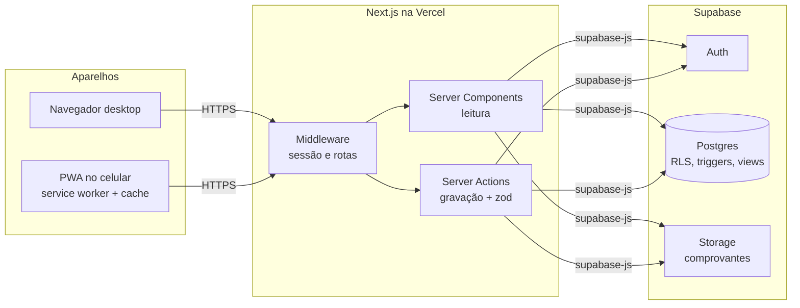

# admBangalo — Arquitetura (parte 1)

Gestão de chalés para o proprietário: desktop + PWA no celular.
Stack: TypeScript, Next.js 15 (App Router), Supabase (Postgres, Auth, Storage).

## Decisões assumidas

- Vários chalés, um proprietário por conta. Toda tabela tem `owner_id` e RLS, então dá para virar multiproprietário depois sem migração.
- Taxas configuráveis por chalé em 5 modos: por estadia, por diária, por pessoa, por pessoa/diária e medida (kWh × tarifa).
- Pagamentos lançados manualmente (Pix, dinheiro, cartão, transferência, plataforma), com parcelas previstas para o "a receber".
- Diárias ficam na reserva; energia, limpeza e extras são cobranças à parte. Totais calculados no banco.
- Interface em pt-BR, valores em R$, fuso America/Sao_Paulo.
- **Mobile first.** O uso principal é no celular (PWA instalado). Toda tela nasce em 390 px e só depois ganha o layout ampliado de desktop (Tailwind: estilos base = celular, `md:`/`lg:` = desktop).

## Diretrizes de UI

- Estilo "natural acolhedor": fundo areia `#F5EFE6`, cartões `#FFFDF8`, verde-musgo `#4A6B3A` (ação principal), terracota `#C0643A` (valores pendentes).
- Tipografia: Fraunces (títulos e números grandes) + Inter (texto e tabelas, `tabular-nums`).
- Cor por chalé no calendário e nos ícones: Ipê musgo, Araucária azul-ardósia `#5E7C8C`, Jabuticaba ameixa `#8B5A6B`.
- Cantos 16–24 px, sombras suaves, alvos de toque ≥ 44 px, ações principais fixas no rodapé do celular.
- Barra inferior no celular: Painel · Calendário · **+ Nova reserva** (botão central) · Hóspedes · Financeiro.

## Arquitetura



Gravações passam por Server Actions; o Postgres confere cada linha pelo RLS.

## Estrutura de pastas

> Atualizada na parte 2: o código fica em `src/`, organizado por features em camadas.
> A estrutura vigente e as regras estão no `README.md` e em `docs/padroes.md`.
> O bloco abaixo é o esboço original da parte 1.

```
admBangalo/
├─ app/
│  ├─ (auth)/login/page.tsx
│  ├─ (app)/
│  │  ├─ layout.tsx            # sidebar (desktop) / bottom nav (mobile)
│  │  ├─ page.tsx              # Painel
│  │  ├─ calendario/page.tsx
│  │  ├─ reservas/ page.tsx · nova/page.tsx · [id]/page.tsx
│  │  ├─ hospedes/ page.tsx · [id]/page.tsx
│  │  ├─ financeiro/page.tsx
│  │  └─ configuracoes/        # chalés, taxas, tarifas sazonais, perfil
│  ├─ manifest.ts             # PWA
│  └─ sw.ts                   # service worker (Serwist)
├─ components/  ui/ (shadcn) · calendar/ · reservation/ · finance/
├─ lib/
│  ├─ supabase/ server.ts · client.ts · middleware.ts
│  ├─ actions/ reservations.ts · payments.ts · guests.ts
│  ├─ validators/ (zod)
│  └─ format.ts               # BRL, datas pt-BR
├─ types/database.ts          # supabase gen types typescript
├─ middleware.ts
└─ supabase/migrations/0001_init.sql
```

Bibliotecas: `@supabase/ssr`, shadcn/ui + Tailwind, `react-hook-form` + `zod`, `date-fns`, TanStack Query, Serwist, Recharts.

| Rota | Tela | Dados |
| --- | --- | --- |
| `/` | Painel | check-ins/outs de hoje, ocupação, a receber |
| `/calendario` | Calendário | `reservations` por chalé |
| `/reservas/nova` | Nova reserva | `chalet_is_available()`, hóspedes, taxas |
| `/reservas/[id]` | Detalhe | `reservation_financials`, cobranças, pagamentos |
| `/hospedes` | Hóspedes | busca por nome/documento, histórico |
| `/financeiro` | Financeiro | `monthly_summary`, pendências |
| `/configuracoes` | Ajustes | chalés, taxas, tarifas sazonais |

## Modelo de dados

| Tabela | Guarda | Campos-chave |
| --- | --- | --- |
| `profiles` | proprietário (1:1 `auth.users`) | nome, telefone, chave Pix |
| `chalets` | chalés | capacidade, hóspedes inclusos, diária base, cor |
| `chalet_rates` | tarifas sazonais | período, diária, mínimo de noites |
| `fees` | modelos de taxa | tipo, modo, valor, aplicar automático |
| `guests` | cadastro de hóspedes | nome, documento, telefone, cidade |
| `reservations` | estadias | check-in/out, adultos, crianças, diária, desconto, status, origem |
| `reservation_guests` | nomes de todos da estadia | nome, documento, criança, principal |
| `reservation_charges` | taxas cobradas | valor unit., quantidade, leitura do medidor, total |
| `payments` | recebimentos | sinal/parcela/saldo/estorno, método, valor, data, comprovante |
| `payment_schedule` | parcelas previstas | descrição, valor, vencimento |

Views (todas `security_invoker`): `reservation_financials` (total, pago, saldo, status por reserva), `monthly_summary` (previsto/recebido/pendente por mês), `occupancy_days` (dias ocupados por chalé).

## Regras de negócio (no banco)

- Sem sobreposição de reservas ativas no mesmo chalé (`exclude using gist`); check-out pode coincidir com o próximo check-in.
- Adultos + crianças ≤ capacidade do chalé (trigger).
- Ao criar reserva, taxas automáticas viram cobranças. Pessoa extra cobra só acima dos hóspedes inclusos. Energia medida = (leitura final − inicial) × tarifa.
- Total = hospedagem + taxas · Pago = pagamentos − estornos · Saldo = total − pago.

Testado em Postgres 16: 3 noites × R$ 350, 3 hóspedes (2 inclusos), limpeza R$ 150, pessoa extra R$ 60/noite, 84,5 kWh × R$ 0,95, sinal R$ 600 → total R$ 1.460,28, saldo R$ 860,28, status parcial. Sobreposição e excesso de capacidade foram recusados; outro usuário não viu nenhum dado.

## Segurança e PWA

- Supabase Auth (e-mail/senha ou link mágico); trigger cria `profiles`.
- RLS `owner_id = auth.uid()` em todas as tabelas; `owner_id` tem default, o app não envia.
- `service_role` nunca no cliente. Comprovantes em bucket privado `receipts/<owner_id>/...`.
- PWA: `manifest.ts`, ícones 192/512 maskable, `standalone`; Serwist faz cache da casca e das últimas leituras. Gravação exige conexão na v1.
- Layout base é o celular; a partir de 768 px a barra inferior vira sidebar lateral.

## Próximas partes

1. Projeto Next.js base: auth, layout responsivo, PWA, tipos do Supabase.
2. Chalés e taxas.
3. Hóspedes, reservas e calendário.
4. Cobranças, pagamentos e financeiro.
5. Extras: recibo PDF, confirmação por WhatsApp, iCal Airbnb/Booking.
